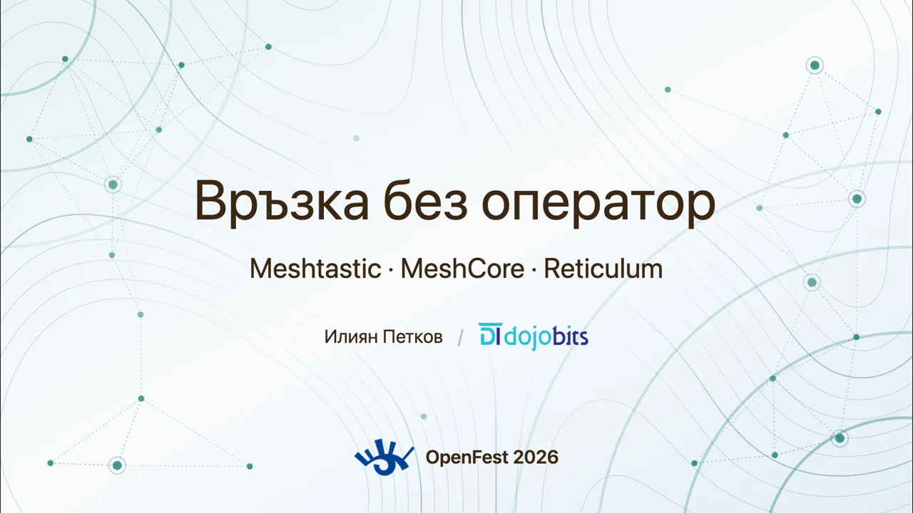
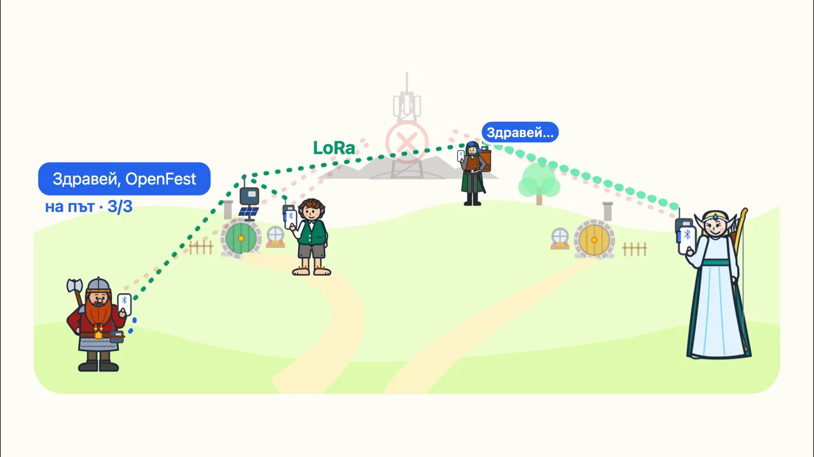
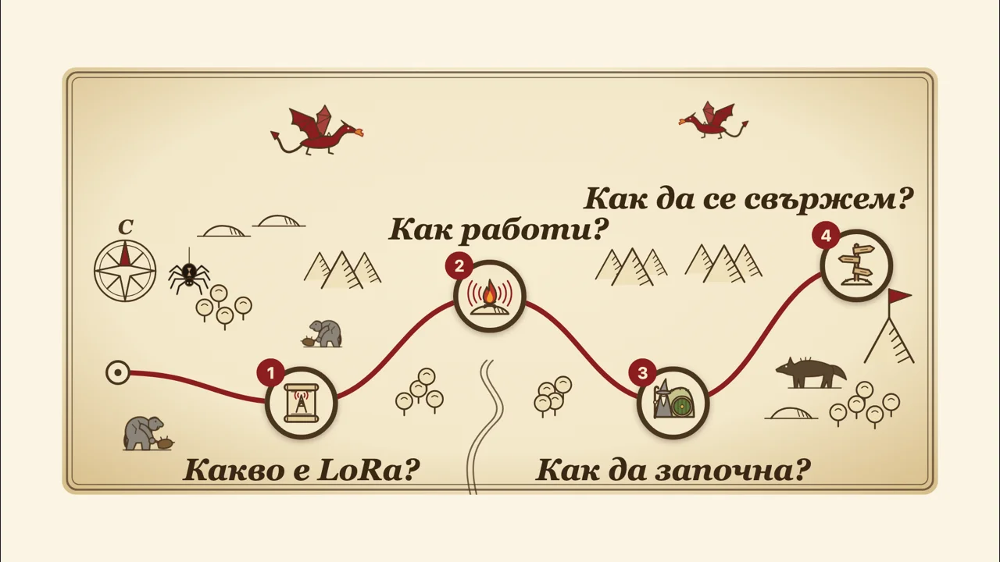
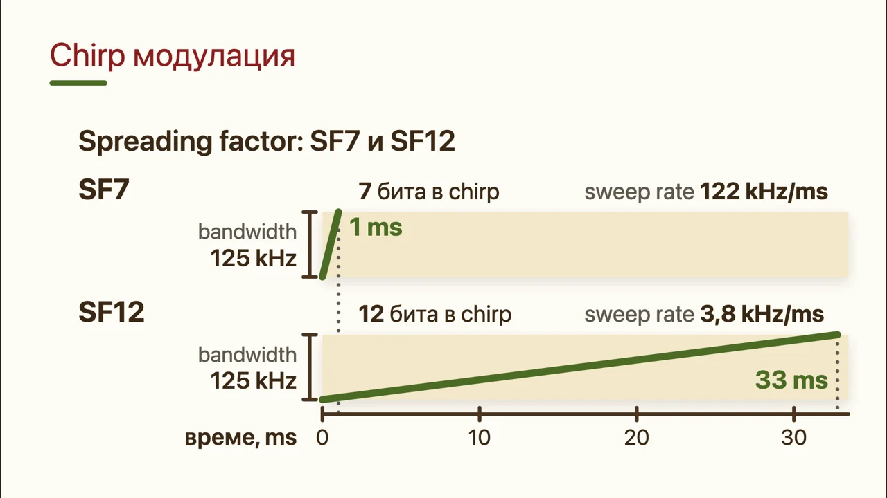
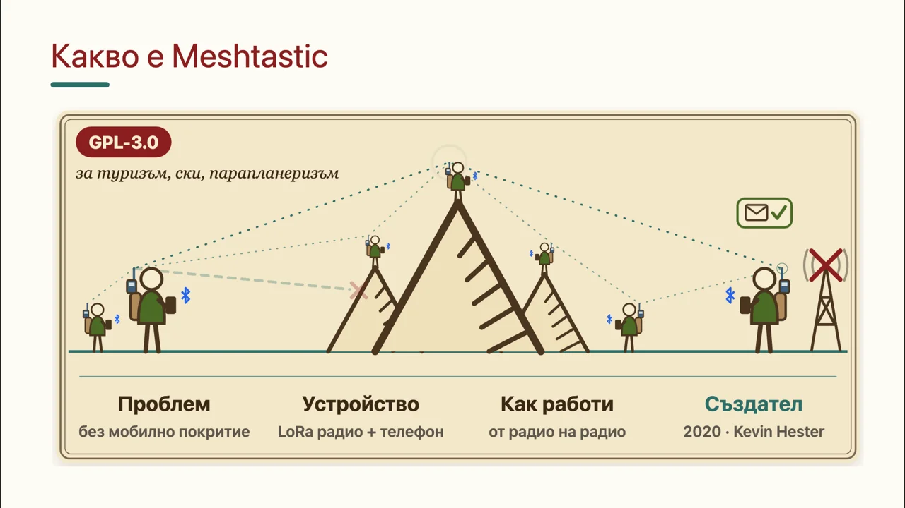
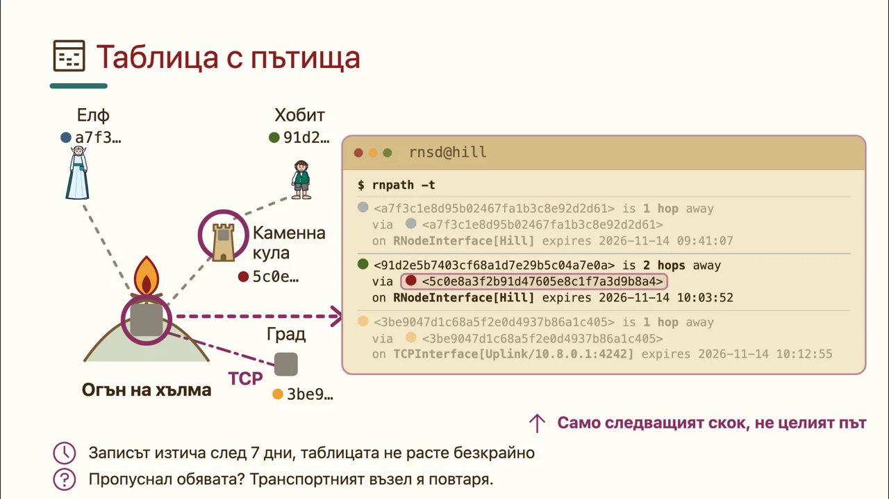

# Връзка без оператор: Meshtastic, MeshCore и Reticulum

Лекция на [OpenFest 2026](https://www.openfest.org/) (София) от Илиян Петков, [DojoBits](https://github.com/DojoBits).

**[Презентацията онлайн](https://dojobits.github.io/openfest-2026-lora-mesh/)** · **[PDF](lora-mesh-without-operator.pdf)**

<table>
  <tr>
    <td><a href="https://dojobits.github.io/openfest-2026-lora-mesh/1"></a></td>
    <td><a href="https://dojobits.github.io/openfest-2026-lora-mesh/2"></a></td>
    <td><a href="https://dojobits.github.io/openfest-2026-lora-mesh/5"></a></td>
  </tr>
  <tr>
    <td><a href="https://dojobits.github.io/openfest-2026-lora-mesh/13"></a></td>
    <td><a href="https://dojobits.github.io/openfest-2026-lora-mesh/28"></a></td>
    <td><a href="https://dojobits.github.io/openfest-2026-lora-mesh/47"></a></td>
  </tr>
</table>

Как телефон, Bluetooth и малко LoRa радио за под 30 € пращат съобщения без мобилна мрежа, и с какво се различават трите свободни мрежи: Meshtastic, MeshCore и Reticulum.

Онлайн версията е интерактивна: стрелките или интервалът показват анимациите клик по клик, `o` показва всички слайдове. PDF файлът съдържа крайното състояние на всеки слайд.

## Съдържание

| Папка | Какво има |
|---|---|
| `slides.md`, `pages/` | Слайдовете ([Slidev](https://sli.dev)), на български |
| `components/` | Vue компоненти за диаграмите. Данните и изчисленията са в `components/data/` |
| `snippets/` | Конфигурации и скриптове от демото (Meshtastic, MeshCore, Reticulum), вижте `snippets/README.md` |
| `setup/`, `DEMO.md` | Как е подготвено демото на живо |
| `docs/screenshots/` | Снимките в този README |

## Пускане

```sh
npm ci
npm run dev      # http://localhost:3030
npx slidev build # статична версия в dist/
npx slidev export --format pdf  # PDF (нужен е playwright-chromium)
```

GitHub Pages версията се публикува автоматично от `.github/workflows/pages.yml` при всеки push в `main`.

## Ключове

Каналът `openfest` в `snippets/meshtastic/base-config.sh` е с фиксиран ключ само за демото и се вижда на слайда за настройка. Не го ползвайте за лична комуникация. За свой канал генерирайте нов ключ (`meshtastic --ch-set psk random`). BLE PIN се генерира при изпълнение на скриптовете.

## Снимки

Авторите и лицензите на снимките на антени са в `public/antennas/CREDITS.md`. Снимките с „All rights reserved“ се ползват с разрешение на собствениците.
